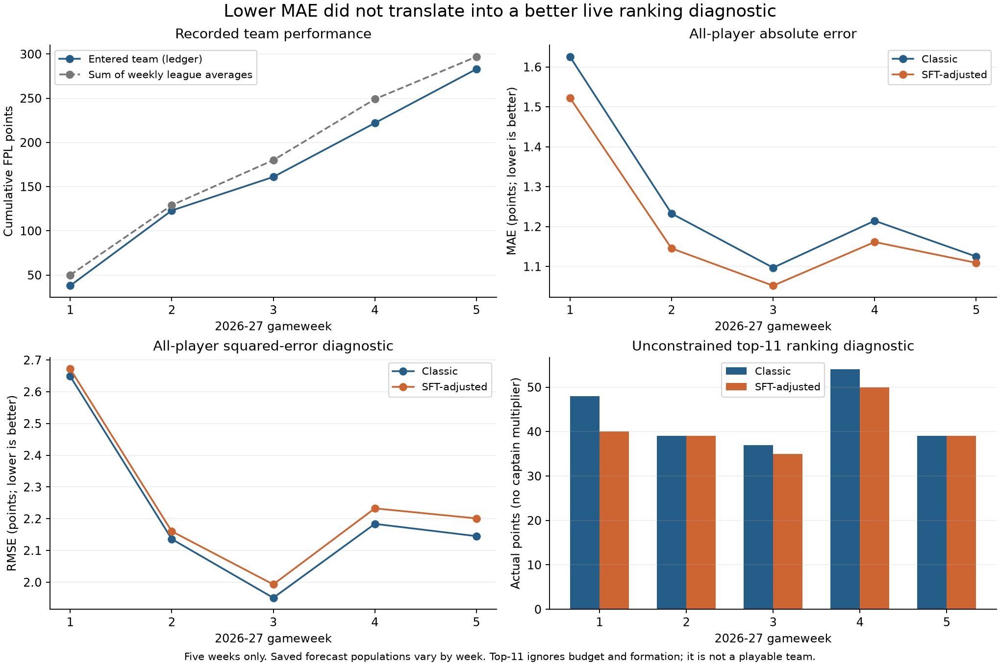

# Review measurements and reproducibility

These are diagnostic experiments, not newly validated deployment models. All outputs are under `Codex/analysis`; all scripts are under `Codex/scripts`. Existing code is imported read-only with bytecode writing disabled. The leakage experiment patches functions in memory, then exits.

## Environment and scope

Interpreter: `/home/wescheng/venvs/fpl-gemma-lite/bin/python`, Python 3.12.3. Recorded versions include numpy 2.4.0, pandas 3.0.2, torch 2.9.1+cu128, TRL 1.0.0, transformers 5.6.0.dev0, PEFT 0.18.1, and pytest 9.1.1. See `analysis/provenance.json` for the complete captured environment and source SHA-256 map.

The system `python3` lacks pandas and TRL, so the first test command failed at import. The existing project environment was then used. Its installed dependencies were not changed. For the optional chart only, matplotlib and its dependencies were installed in the isolated `Codex/.plot_deps/` directory; only `plot_review.py` adds that location to its import path.

No Git repository was found at the current directory or its parents. Source hashes provide a limited review snapshot; they are not a substitute for version control or full artifact provenance. Large model weights were not loaded or hashed. No historical article versions were recovered from the web.

The main inspected data table contains 194,240 player-week rows spanning 2019-20 through 2026-27 GW5. The other tables have different live cutoffs. The current numerical training configuration therefore includes the new season's completed weeks; the saved E11-full SFT manifest stops at 2025-26 GW38. “Trained through 2025-26” should distinguish the frozen adapter from the updated classical model.

## E1 — Existing tests

```bash
PYTHONDONTWRITEBYTECODE=1 PYTHONPATH=src OPENBLAS_NUM_THREADS=1 \
  /home/wescheng/venvs/fpl-gemma-lite/bin/python \
  -m pytest -q -p no:cacheprovider tests \
  > Codex/logs/pytest.log 2>&1
```

Result: **76 passed, 12 failed**, 8.34 seconds reported by pytest. The 12 failures arise from `KeyError: goals_scored` in the feature builder's numeric conversion on synthetic inputs. The missing optional/required-column contract also warrants checking `assists`. The completion-mask tests passed.

`unittest discover` ran 63 tests and reported 12 errors; it did not collect all module-level pytest tests. Its log is retained as `logs/unit_tests_venv.log`. The initial system-Python dependency failure is in `logs/unit_tests.log`.

Interpretation: the current code is not supported by a green full suite. These failures do not mean every production ingestion crashes; the normalized production files contain the missing fields. They show a schema/test regression and leave meaningful correctness coverage broken.

## E2 — Structural and behavioral reproductions

```bash
PYTHONDONTWRITEBYTECODE=1 PYTHONPATH=src OPENBLAS_NUM_THREADS=1 \
  /home/wescheng/venvs/fpl-gemma-lite/bin/python Codex/scripts/audit.py \
  > Codex/logs/audit.log 2>&1
```

This emits the following:

| Artifact | Measurement |
|---|---|
| `table_audit.json` | Table dimensions, features, duplicates, multiweek cutoff crossing, concrete target examples |
| `units_and_status.json` | Ownership-unit distributions, snapshot field presence, flags, first-week zero prices |
| `season_centering.json` | Full-season versus prefix reference used by F6 |
| `code_probes.json` | Formation, substitutions, future-prompt dependency, chip baseline, FT cap, price, parser/application behavior |
| `prior_blend_parity.json` | Live helper with and without required prior-season context |
| `live_analysis.json` / `live_forecast_rows.csv` | Identity-matched saved forecasts versus completed-week outcomes |
| `e19_decomposition.json` | Independent shrink/remainder decomposition of saved E19 outputs |
| `rl_naive_chip_benchmark.json` | Fixed chip schedule in the existing RL environment |
| `experiment_metrics.csv` | Numeric fields extracted from saved residual evaluation summaries |
| `backtest_inventory.json` | Existing backtest paths and available summary totals |
| `provenance.json` | Interpreter, dependencies, source hashes |

Key observed results:

- No duplicate `(season, week, player_id)` keys in the audited table.
- At 2025-26 GW27, 3GW labels from origins 25–26 and 5GW labels from origins 23–26 remain in training. A one-week origin cutoff is insufficient.
- 2025-26 ownership median 19,545 and maximum 9,515,178 in a “percent” field.
- F6's saved input-column full-season conceded mean is 1.9431 versus 2.2356 over the pre-GW27 prefix. Exact raw-stage means can differ in their handling of missing values; source code is the decisive evidence that the mean uses all season rows.
- Existing XI search returns projected 74 versus a legal 5-2-3 projected 83 in a deliberately constructed squad.
- With four absent outfield starters and three legal available replacements, autosub code makes zero outfield replacements.
- Mutating only a future state's forecasts changes the opening RL plan prompt.
- Holding with four free transfers produces two next week instead of the current-rules five.
- Buying at 5.0 and a market price of 5.4 yields simulated sale value 5.4 instead of 5.2.
- A two-object newline plan parses successfully but drops the second requested action.
- Nonfinite numeric JSON can be converted into a bound value rather than rejected.

These are focused counterexamples, not a complete rules certification suite. Their purpose is to make repair requirements concrete.

## E3 — Live prior-context parity

The audit calls the production `_build_next_week_form_features` using the saved raw history and `FPL_PRIOR_BLEND=1`. It then calls the same helper with an in-memory wrapper that supplies the preceding season to the feature builder, retaining only the requested current-season output.

Result: 420 of 667 GW6 players have different `points_avg_3` values. Examples are recorded in full in `prior_blend_parity.json`.

This isolates the missing-context mechanism. It is not a full alternative forecast run, does not repair historical status or other timestamp defects, and does not measure FPL score improvement. It tests current source using archived history through GW5, not a guaranteed byte-for-byte reconstruction of the source used on every earlier live deadline.

The first local version of this probe needed two corrections: updating a frozen dataclass via `replace`, and filtering previous-season rows from the comparison output. Those failed diagnostic runs are retained in `logs/audit_initial_error.log` and `logs/audit_prior_probe_error.log`. They are errors in review code, not additional defects attributed to the application. The final full audit completed successfully.

## E4 — Saved live forecast scoring

The script reads these existing forecast pairs:

| GW | Examples | Predictions |
|---|---|---|
| 1 | `live_gw1_2627_examples_wed.jsonl` | `live_gw1_2627_e10_predictions_wed.jsonl` |
| 2 | `live_gw2_2627_examples_v2.jsonl` | `live_gw2_2627_e11full_predictions_v2.jsonl` |
| 3 | `live_gw3_2627_examples.jsonl` | `live_gw3_2627_e11full_predictions.jsonl` |
| 4 | `live_gw4_2627_examples_v2.jsonl` | `live_gw4_2627_e11full_predictions.jsonl` |
| 5 | `live_gw5_2627_examples.jsonl` | `live_gw5_2627_e11full_predictions.jsonl` |

All are under `reports/`. The deliberately named broken GW2 prediction artifact is excluded. GW4 uses v2 examples and verifies identity alignment against the saved predictions. The audit observed zero paired ID mismatches in these five selections. Actual labels come from the saved completed current-season training rows, keyed by player ID and week.

All-player MAE improves in every week, all-player RMSE worsens in every week, and the unconstrained top-11 actual-point diagnostic loses or ties in every week. Exact values are in `REVIEW.md` and `live_analysis.json`.

The likely-player slice uses classic `P(appear) >= 0.5`, selected without seeing outcomes. It avoids evaluating only actual starters, which would select on the outcome and hide availability failures. This slice is still defined by a miscalibrated baseline probability; it is a diagnostic subgroup, not a definitive candidate universe.

Evidence is present for 71–88% of matched live rows in these whole-pool files. Older reports quote different coverage percentages for different pools. Raw presence is not evidence relevance, correctness, freshness, or incremental predictive information.

Limitations: rows without historical outcomes cannot be scored; a pre-deadline missing-outcome/registered-player audit is needed before treating the matched pool as exhaustive. The scoring mirrors live point flooring and shared delta bounds. It does not replay the actual squad discussions, calculate official rank, or isolate causal effects of SFT on transfers.

## E5 — E19 shrinkage mechanism

For each of the 12 saved evaluation weeks, regress emitted SFT 1GW delta on an intercept and the saved classic 1GW prediction. Evaluate the classic prediction plus that fitted component, and classic plus the remaining player-specific component, against saved one-week targets.

Classic MAE is 2.271570; SFT MAE 2.135785; shrink-only MAE 2.147790; remainder-only MAE 2.259014. The shrink component accounts for approximately `(2.271570−2.147790)/(2.271570−2.135785) = 91.2%` of the MAE gain. Full SFT changes mean error from +0.038844 to -0.450771. The player-specific remainder reduces RMSE from 3.042258 to 3.026036 in this descriptive analysis.

This independently reproduces the key numeric mechanism reported in `reports/adapter_bench_2026_09_29/README.md`. It does not independently reproduce that document's entire 21-window benchmark; its referenced derived output files were not all present in that directory. The review does not promote its +165 availability-normalization result as a validated new finding.

The decomposition needs an adapter output to calculate the fitted component and has been inspected post hoc. It is not a free replacement model, evidence of no text use, or proof that removing shrink improves squad points. The next proper experiment is a numeric calibrator trained only on earlier folds and then frozen for evaluation.

## E6 — RL no-model chip comparison

Policy: play BB at the first available week of a half, TC at the next, otherwise the default action. Chip legality is carried across six-week windows using the existing half-season bookkeeping. No outcomes or future forecast rankings are used to select its chip timing.

| Existing state cache | No-chip baseline | Fixed chip policy | Difference |
|---|---:|---:|---:|
| Classic | 968 | 981 | +13 |
| Adjusted | 940 | 955 | +15 |

This reproduces the environment's known baseline totals and establishes that a positive reward can be earned by spending chips without learning. It is not a proposed production chip policy. The scorer omits autosubs, squads reset between windows, and the final leftover week is absent. Different learned policies can still outperform this deliberately simple comparator.

## E7 — Partial label-purge sensitivity

```bash
PYTHONDONTWRITEBYTECODE=1 OPENBLAS_NUM_THREADS=1 OMP_NUM_THREADS=1 \
  /home/wescheng/venvs/fpl-gemma-lite/bin/python \
  Codex/scripts/leakage_sensitivity.py \
  > Codex/logs/leakage_sensitivity.log 2>&1
```

For each forecast origin, refit the 3GW and 5GW heads after removing origins whose horizon extends into that forecast week; leave the 1GW and minutes heads unchanged. Run both arms through the same existing default simulator, F6 feature table, initial budget, and separate window starts.

| 2025-26 window | Existing actual points | Purged actual points | Difference |
|---|---:|---:|---:|
| GW27–30 | 258 | 258 | 0 |
| GW31–34 | 234 | 234 | 0 |
| GW35–38 | 270 | 270 | 0 |

The outputs are not identical: maximum absolute changes in selected-squad 5GW predictions are approximately 0.540, 0.477, and 0.530, respectively. Decisions and realized totals stayed the same in these windows. All arms record zero hits.

This is a sensitivity analysis for one defect, not clean performance evidence. It retains full-season preprocessing, historical lookup problems, scoring/rule defects, chip-window effects, and synthetic starting squads. No old SFT deltas were applied to the newly purged baseline. Do not use the unchanged scores to conclude that target maturity can be ignored; do not use the bug alone to claim inflated realized scores.

## Chart

```bash
/home/wescheng/venvs/fpl-gemma-lite/bin/python -m pip install \
  --target Codex/.plot_deps --no-cache-dir matplotlib
PYTHONDONTWRITEBYTECODE=1 \
  /home/wescheng/venvs/fpl-gemma-lite/bin/python Codex/scripts/plot_review.py
```

The figure is generated entirely from saved diagnostic outputs. It presents descriptive five-week values without implying statistical confidence from five observations.


