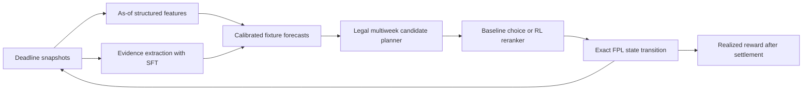

# Implementation and research plan

The intended outcome is a reproducible FPL system that maximizes expected season points, with SFT adding useful pre-deadline information and RL improving sequential decisions over a strong planner. This plan is a proposal for implementation; the review has not changed production behavior or trained a replacement.

## The next deadline

Before changing adapters, save an immutable packet for the actual team. Include the full 15, purchase and current selling prices, bank, FTs, remaining chip copies and expiry windows, deadline, and snapshot retrieval time. Reconcile it with the entered team rather than assuming the latest generated recommendation was entered.

Correct or disable the ownership features with incompatible units. Repair the live prior-context path and compare the resulting numerical inputs against a historical replay from the same snapshot. Do this on a separate candidate model configuration; the existing SFT adapter was trained against a different baseline and must not automatically be attached to a changed anchor.

Produce side-by-side forecasts for the existing stack and corrected numerical candidate, then a legal decision sheet from each. The sheet must contain starters, ordered outfield bench, reserve GK, captain, vice, transfer cost, bank after moves, and any chip. Every discretionary override gets a reason and timestamp. Treat disagreement as a reason to inspect evidence, not as proof that the more complicated model is right.

The immediate release gate is data validity and legal/consistent decisions. It is not “win the next gameweek.” If a required field is missing or a forecast was generated against incompatible baseline/schema versions, fail loudly and use a clearly identified last-valid process.

## Phase 1 — Trustworthy data and evaluation contract

**Planning estimate: 3–5 focused engineering days for the core contract, with historical recovery potentially longer.** Priority items are P0-01 through P0-05 and P1-01 in `CODE_FINDINGS.md`.

Deliver:

- Typed, unit-checked canonical tables for players, deadline snapshots, fixtures, outcomes, and evidence.
- Explicit unknown values where historical status/news/ownership percentages cannot be recovered.
- One as-of feature builder used by offline and live paths.
- Per-target outcome end and availability timestamps; purged training selection shared by every exporter/trainer.
- Fold-local preprocessing and stable player/club identity across seasons and transfers.
- Immutable snapshot, model, data, prompt, and code manifests.

Suggested minimum records:

```text
Snapshot:
  snapshot_id, season, event_id, deadline_at, captured_at,
  source, content_hash, valid_until, ruleset_id

PlayerSnapshot:
  snapshot_id, player_code, season_element_id, club_id, fpl_position,
  purchase_price_tenths, market_price_tenths, sell_price_tenths,
  selected_count?, ownership_fraction?, ownership_denominator?,
  availability_status?, chance_next_round?, news?, news_updated_at?

TrainingExample:
  prediction_origin_at, player_code, fixture_ids,
  feature_schema_id, feature_snapshot_ids,
  target_name, target_value, label_end_at, label_available_at,
  observed_horizon_length, target_scoring_ruleset_id
```

Use `available_at <= prediction_origin_at` for any input. For supervised targets, require `label_available_at < training_cutoff_at`. Publication time, content update time, fetch time, and the effective date of a fact are not interchangeable. Historical snapshot uncertainty must be visible in evaluation metadata.

For multiweek labels, do not disguise a one-week observation as five realized weeks. Either train fixture-level/one-week expectations and sum actual scheduled future fixtures, or mask immature/truncated horizon labels and record the remaining horizon. A rate-equivalent target may be useful, but name and evaluate it as a rate.

For new players and promoted clubs, use partial pooling with explicit uncertainty: position/role/price priors, available prior-league performance with a learned league adjustment, and preseason role information captured before the deadline. Do not infer nonparticipation merely from missing history. Do not map unknown player codes together under a shared placeholder.

Acceptance gates:

1. Future-outcome, future-news, and future-fixture mutations cannot change past features or the policy's past observations.
2. No percentage/count or price-unit ambiguity; no undetected duplicate keys.
3. Historical and live builders produce matching inputs from the same snapshot.
4. Known missing fields remain missing, with a defined model fallback.
5. An audit can identify exactly which source versions and target windows trained every model.

This phase invalidates portions of old corpora and caches. Archive them with their old manifests; rebuild the affected artifacts under new names. Old adapters remain useful historical comparisons, but do not certify them against newly redefined baselines.

## Phase 2 — One exact FPL state transition and scoring engine

**Planning estimate: 4–7 engineering days, partly concurrent with historical-data recovery.** Finish P1-03 through P1-12 before interpreting another RL reward curve.

Implement a season-versioned game state:

```text
GameState = (
  season, gameweek, ruleset,
  owned_players_with_purchase_prices,
  bank_in_tenths, saved_free_transfers,
  chips_remaining_by_copy_and_expiry,
  temporary_free_hit_state,
  entered_lineup, bench_order, captain, vice
)
```

There should be one `validate_action`, one `transition`, and one `score_realized` implementation. The backtest, RL environment, live recommendation validator, and settlement report must call them. Separate final FPL rules from the planner's approximate expected-value calculation.

Handle formations, club limits, selling-price rounding, hits, saved transfers, each chip, chip expiration, FH reversion, autosubs with incomplete teams, vice-captain fallback, blanks/doubles, and season-specific rules. Keep fielded minutes separate from whether a player appeared in any match of a double gameweek.

Build a small corpus of official settled team histories for validation, when public history is available. Include difficult substitution/price/chip cases rather than only ordinary full-XI weeks. Hand-worked synthetic cases cover gaps, but are not substitutes for real comparison.

Acceptance gates:

1. Existing suite passes; current 12 failures are resolved.
2. Scorer matches every archived official case used in the certification set, including hits and autosubs.
3. Bank and squad accounting conserve value according to the rules across transfer sequences.
4. State persists across the entire evaluated season; every gameweek is accounted for.
5. No legal-plan validation relies on the language model behaving correctly.

## Phase 3 — Forecast baselines worth improving

**Planning estimate: 1–2 weeks. CPU first; no large-model training required for the initial comparisons.**

Pre-register a compact model ladder. Use identical pre-deadline features, folds, candidate universe, and decision optimizer wherever the purpose is to isolate forecast quality.

| ID | Model | Purpose |
|---|---|---|
| B0 | Shrunk prior-season/current-season rate with explicit availability | Hard-to-beat sanity baseline; exposes pipeline failures |
| B1 | Repaired pooled ridge with position/era interactions | Preserve the current approach as a fair reference |
| B2 | Regularized boosted trees for 1GW expected points + calibrated availability | Test useful nonlinearities without hand-writing every interaction |
| B3 | Fixture/component model for minutes, attacking returns, clean sheets, DC, bonus | Represent FPL scoring and transfer future forecasts explicitly |
| B4 | Validated ensemble of B1/B2/B3 | Reduce model-specific bias only if it wins independently |

Choose one of LightGBM, CatBoost, or an already available histogram gradient booster for B2; do not spend weeks benchmarking libraries. Train expected-points outputs using a mean-targeting objective and separately score calibration. Count objectives belong on nonnegative events such as goals, not on raw FPL point labels that can be negative. [LightGBM objective documentation](https://lightgbm.readthedocs.io/en/latest/Parameters.html).

A useful component expression is:

```text
E[FPL points per fixture] =
  E[appearance points from the minutes distribution]
  + position_goal_value × E[goals]
  + 3 × E[assists]
  + position_clean_sheet_value × P(eligible clean sheet)
  + E[save points]
  + 2 × P(defensive-contribution threshold reached)
  + E[bonus] - E[deductions]
```

These terms have dependencies: clean-sheet eligibility depends on minutes; bonus is relative to the rest of the match; defensive contributions depend on role and opportunity. A first implementation may approximate those dependencies, but must state them. Avoid multiplying an unconditional expected-points number by appearance probability a second time.

Forecast `P(no appearance)`, `P(cameo)`, `P(start <60)`, and `P(60+)`, or an equivalent coherent distribution. Do not use expected minutes/90 as `P(appear)`. For doubles, forecast each fixture and their dependence, then aggregate. For premiums, inspect bias both unconditional and conditional on 60+ minutes; otherwise rotation can masquerade as a quality-model failure.

Use uncertainty to communicate stability and support scenario planning. For the default objective of maximizing expected points, club correlation alone is not a reason to diversify; it matters for variance, chip coverage, risk constraints, or rank utility. Treat rank-chasing as an explicit later objective rather than silently rewarding low ownership.

Acceptance gates:

- Beat B0/B1 on held-out mean calibration and at least the decision-relevant scoring metrics; no win based only on all-player MAE.
- Report player availability Brier/log loss, minutes metrics, mean-points bias, RMSE, and ranking by week.
- Break out captain candidates, owned players, low-cost enablers, new/promoted players, GW1–6, injury returners, congested weeks, blanks, and doubles.
- Forecast changes must improve paired decision value in the common simulator before deployment.
- Preserve a replayable prediction file for every tested player and deadline.

## Phase 4 — Make SFT earn its text channel

**Planning estimate: 1–2 weeks for a focused extraction pilot; run only after the baseline is frozen.**

Use SFT first for a task whose labels can be checked without knowing the subsequent match result. Suggested output:

```json
{
  "player_code": 123,
  "as_of": "<deadline timestamp>",
  "availability": "uncertain",
  "expected_role": "unknown",
  "return_window": null,
  "set_piece_change": null,
  "affected_teammates": [],
  "claims": [
    {
      "fact_type": "training_status",
      "value": "partial_training",
      "source_document_id": "<content hash>",
      "supporting_span": "<verbatim source span>",
      "confidence": 0.7
    }
  ]
}
```

The example is a schema illustration, not an assertion about a real player. Numerical confidence must eventually be calibrated; initially it can be an ordinal extraction-confidence category.

Construct an adjudicated development/evaluation set stratified by relevant events: injury, return, late fitness test, rotation, manager change, rival absence, penalty duty, transfer, and ambiguous names. Include negative examples and explicit unknowns. Start with hundreds of carefully checked snippets before scaling automatically generated labels. Split by event/article cluster and time so the same syndicated story cannot appear on both sides.

Run these ablations with the same numerical anchor:

| Arm | Input to the prediction model | What it tests |
|---|---|---|
| S0 | Structured data only | Reference |
| S1 | Deterministic official-status/news features | Value available without an LLM |
| S2 | Frozen/base LLM extraction | Value of text extraction before SFT |
| S3 | SFT extraction | Incremental value of fine-tuning |
| S4 | Numeric residual calibrator, no text | Whether numeric recalibration explains the gain |
| S5 | Existing-style residual SFT with frozen matching baseline | Whether direct deltas still add value |
| Controls | Removed, shuffled, stale, and wrong-player evidence | Whether the asserted text mechanism is real |

Do not allow the shuffled or stale controls into production. They are offline experiments to diagnose whether predictions actually depend on the claimed evidence.

Keep hard field limits and strict schemas. If using direct residual SFT, save the exact baseline prediction and baseline-version hash in every example. Stop silently moving the anchor underneath an old adapter. Test conditional mean calibration and decision value, not just token accuracy, JSON rate, or MAE. Consider a numeric regression head or learned residual calibrator after text extraction if greedy numeric JSON continues to understate hauls.

Suggested pilot gates, to be fixed before looking at results: at least 95% precision for explicitly supported high-confidence availability claims on the adjudicated set; near-zero wrong-player attribution; zero use of post-deadline document versions; calibrated downstream probabilities; no material regression on premium/captain and returner slices; positive incremental decision value versus S0/S1/S2/S4 under the statistical protocol below. These are proposed targets, not measured current performance.

If S3 helps extraction but not FPL decisions, keep it as evidence support and explanation. Do not force a numeric adjustment for every article. No new information should usually mean no new adjustment.

## Phase 5 — A planner that values the actual fielded team

**Planning estimate: 1–2 weeks, beginning after the scorer is correct.**

Build a deterministic multiweek optimizer, initially 4–6 weeks with a terminal value for assets and unused resources. Use current information for every future projection; replan each actual deadline. This is also the benchmark that RL must beat.

At each horizon week, choose owned squad, transfers, starting XI, captain, vice, ordered bench, and chip. Respect budget, position, club limits, purchase/sell accounting, FT accumulation, hit costs, chip copies and expiry, WC/FH mechanics, and evolving prices under stated scenarios. Terminal values should prevent spending all chips or dumping useful players just because the evaluation window ends.

Optimize expected fielded points. Expected captain fallback and autosubs depend on the minutes distribution; estimate them by a compact scenario set or exact enumeration where tractable. Evaluate multiple bench orders, not just raw point sorting. Under uncertain availability, a lower-ceiling but reliable legal replacement can change the value of the starting XI.

Use an exact solver on small/static problems to check the existing beam/pruned search. A heuristic can remain in production if its approximation gap and runtime are acceptable. Build candidate transfers by position, price range, baseline value, fixture horizon, and budget-enabling role. Include hold and genuine coordinated moves. Do not prune every potential downgrade merely because its own forecast gain is negative.

Acceptance gates:

- Exact equality with exhaustive solutions on small cases and documented solver gap for large ones.
- Same forecast set and initial squad in paired optimizer comparisons.
- Better cumulative points/resource use than one-transfer greedy over continuous historical replay, with uncertainty reported.
- Identical optimizer behavior in live and backtest calls when inputs match.
- A plan exposes contingency triggers rather than promising that a future transfer must be taken regardless of new information.

## Phase 6 — RL after the environment is worth learning

**Planning estimate: 1–2 weeks for a small pilot after prerequisites; expand only if signal survives.**

Use a weekly closed-loop policy over a legal candidate set. Candidate actions can contain hold, transfer sets, lineup/captain variants, and chip choices. The numerical planner handles feasibility and provides a competent action prior. The policy receives the actual current team and resources, distributions over future points, schedule known now, and timestamped evidence features.



Train a small action-ranking/value model as a cheap baseline before another generative GRPO run. Behavior cloning from the planner gives the policy valid, sensible behavior initially. If a generative policy is retained, use a strict action schema; invalid requests are rejected/masked rather than silently interpreted as successful plans.

Historical player outcomes can support counterfactual team scoring because your FPL selection does not cause the football result. But there are only a few seasons of market/schedule outcomes; thousands of overlapping episodes do not create thousands of independent seasons. Augment starting squads, bank, FTs, chips and legal trajectories to improve state coverage, while keeping outcome eras and time splits intact. Distinguish historical replay from simulated stochastic futures.

Reward is exact net FPL points. A paired planner return can reduce variance, but both arms must have the same information and resources. Include resource terminal value if training on finite fragments. Use stochastic forecast scenarios for robustness and evaluate on untouched chronological replay plus prospective shadow operation. Never put realized outcomes or later-deadline forecasts into opening observations.

Track: valid legal actions, full-plan compliance if plans remain, zero-reward-variance groups, meaningful action diversity, entropy, KL, reward distribution, chip use, FT stock, hits, and advantage over the strong reference. For G4-style decision-aware forecasting, retain a calibration constraint and provide the portfolio context; otherwise a “forecast” becomes a hidden portfolio-specific action score.

Stop the pilot if a fixed heuristic or the deterministic planner matches it, if rewards improve only because of extra chip expenditure, if performance is dominated by one season/window, or if the purported strategy cannot be explained through legal action changes. More epochs are not the default response to a flat pilot.

## Statistical protocol and promotion policy

The many already examined 2025-26 windows are development data. E19's wider origin holdout is an improvement over four weeks, but it is not a fresh independent test after repeated design choices on the same season, and its targets still require maturity auditing. The first five live weeks are now diagnosis data. Neither can be relabeled untouched.

Use nested chronological evaluation. Within each outer origin, perform feature/model/hyperparameter selection only on earlier data, with per-target maturity purging. Group by deadline when splitting; a standard row-based time splitter does not understand that hundreds of players share the same week. The time-gap concept is supported by [scikit-learn's chronological splitter](https://scikit-learn.org/stable/modules/generated/sklearn.model_selection.TimeSeriesSplit.html), but the project needs target-availability logic, not just a fixed number of player rows.

For every comparison, save weekly paired differences from the same starting state, scorer, forecasts where appropriate, and resource budget. Report cumulative net points, points per gameweek, captain contribution, transfers/hits, autosub contribution, and terminal resources. Use season-level summaries and contiguous-block resampling/sensitivity analyses; shared chips, squad carryover, and overlapping horizons make independent-row t-tests inappropriate. With only a few seasons, intervals are imprecise and should be presented as such.

Primary target: expected season net FPL points. Primary empirical gate: paired realized net points in the validated replay, followed by prospective shadow outcomes. Secondary gates: calibration, probability quality, decision-relevant slices, reproducibility, and stable runtime. MAE, parse rate, and training reward alone cannot promote a model.

Before a substantial GPU experiment, record:

```text
Hypothesis and proposed mechanism
Frozen baseline and challenger IDs
Data / feature / prompt / ruleset hashes
Fit cutoffs and target maturity policy
Chosen folds and evaluation universe
Primary metric and minimum useful effect
Allowed hyperparameter choices and compute cap
Failure / stop / promotion conditions
```

A suggested minimum useful effect for planning is roughly +1 expected net point per GW against the strong reference, with a uncertainty interval and worst-slice limits specified in advance. This is a practical target, not a claim of achievable gain. Do not claim demonstrated superiority if the paired interval is compatible with substantial harm. If evidence is inconclusive, keep the incumbent and continue shadow collection rather than selecting the nicest window.

Freeze the next unplayed weeks as the prospective test before examining outcomes. Eight to twelve weeks can give useful operational evidence, but may still be insufficient for a small strategic edge. Roll back immediately for invalid inputs, illegal decisions, or broken calibration contracts. Do not automatically roll back a statistically plausible policy after two unlucky scores.

## Suggested execution board

| Order | Deliverable | Dependency | Done when |
|---|---|---|---|
| 1 | Ownership/status provenance repair and artifact quarantine | None | Unit/timestamp invariants pass |
| 2 | Label maturity and fold-local features | 1 | Future mutations cannot affect earlier fits |
| 3 | Live/replay parity and immutable deadline packet | 1–2 | Same snapshot yields same inputs and forecasts |
| 4 | Shared rules/scorer/state engine | Can start with 1 | Official/synthetic cases match; suite green |
| 5 | Baseline ladder and calibration report | 1–4 | Reproducible paired benchmark with credible slices |
| 6 | SFT extraction and controlled residual ablations | 5 | Incremental text effect established or explicitly absent |
| 7 | Multiweek deterministic planner | 4–5 | Beats/checks greedy fairly; exact small-case agreement |
| 8 | RL imitation + small reward-learning pilot | 6–7 | Beats strong same-resource reference or stop |
| 9 | Prospective shadow promotion | Continuous after 3–5 | Frozen pipeline clears statistical and operational gates |

For one developer, a serious rebuild-and-validation cycle is plausibly six to eight weeks, with data archival recovery and prospective observation potentially longer. Treat this as sequencing guidance, not a delivery guarantee. Most immediate value is in the first three deliverables, and they do not require another multi-day LLM training job.
